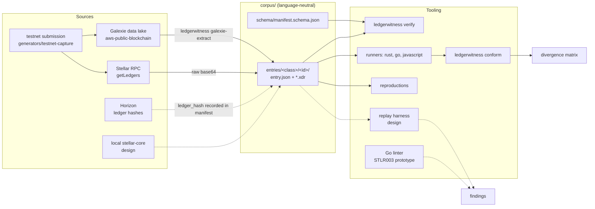
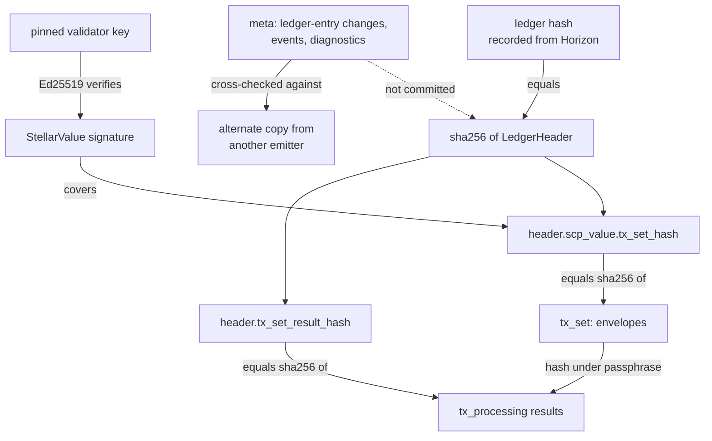
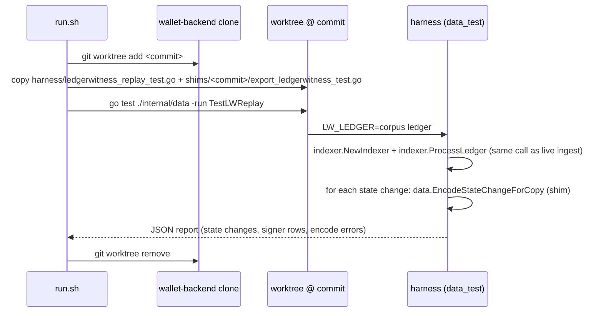

# Technical architecture

This document describes the whole system: what each component does, the data
it exchanges, the algorithms behind each check, the trust model, and how the
parts that are still being built will attach to the parts that exist. Each
section says whether it describes **implemented** behaviour (code in this
repository, covered by tests or recorded runs) or a **design** (planned, not
yet built).

SDK versions below describe the pinned development baseline, not a claim
about the latest upstream releases. Historical observations are recorded
evidence; they are not a fresh network capture. Implementation gaps and
acceptance gates are in section 19.

Contents:

1. Goals and non-goals
2. System overview
3. Repository layout
4. The corpus: data model
5. Generators: how artifacts are obtained
6. `ledgerwitness`: verification, normalization, conformance
7. Provenance and trust model
8. LedgerCloseMeta equivalence
9. Conformance runners and probes
10. Divergence matrix
11. Historical reproductions
12. Replay harness and adapters (partial implementation)
13. Indexer linter (STLR003 prototype; other rules design)
14. Indexer-hardening guide (design)
15. Security, resource bounds and threat model
16. Testing and CI
17. Versioning and protocol upgrades
18. Known limitations
19. Architecture review decisions and acceptance gates
20. Requirements traceability

---

## 1. Goals and non-goals

**Goals**

- A corpus of rare but valid Stellar ledger shapes, one entry per shape, tagged
  with the CAP and protocol version that introduced it, usable from any
  language.
- Each entry is ledger data stellar-core actually emitted, with checkable
  provenance; constructed data is labelled and admitted only with evidence.
- Each entry carries expected decoded values, so an SDK can check both
  decoding and byte-exact re-encoding.
- Runners that put the corpus through the Rust, Go and JavaScript SDKs and
  report where they diverge from the network and from each other.
- A replay harness that feeds the corpus to indexers through inputs they
  already consume, a Go linter for three ingestion mistakes, and a guide for
  indexer authors.
- Offline generation under both network passphrases using isolated local
  state, with no public mainnet keys or funds.
- Everything that checks the corpus runs offline and fast enough for every
  pull request.

**Non-goals**

- Reimplementing XDR, hashing or signature logic. The project uses the
  official libraries (rs-stellar-xdr, go-stellar-sdk, js-stellar-sdk).
- Proving an indexer correct. The harness detects specific mishandled or
  dropped shapes; the linter flags specific patterns. Neither is a complete
  analysis.
- Mainnet transaction generation. New shapes are produced on testnet or by a
  local core; mainnet history is read, never written.

## 2. System overview



The flow has three stages:

1. **Acquisition** (network, run rarely). Artifacts come from public history
   or from transactions we submit to testnet. The bytes are stored in the
   repository together with how they were obtained.
2. **Verification** (offline, every pull request). `ledgerwitness verify` checks entries
   against their manifests. For supported core-emitted ledgers, it checks
   header/transaction commitments against the recorded source hash; it does
   not independently authenticate that source or every metadata field.
3. **Use** (offline). SDK runners, the divergence matrix, historical
   reproductions and, later, indexer replay consume the verified entries.

## 3. Repository layout

```
corpus/                         language-neutral deliverable
  README.md                     format reference for consumers
  schema/manifest.schema.json   JSON Schema 2020-12, version 0.1.0
  replay/                       three versioned replay oracle sidecars
  entries/
    core-emitted/<id>/          core_emitted_valid
    synthetic-validated/        synthetic_validated (admission rules in README)
    sdk-negative/               sdk_negative_only (admission rules in README)
crates/ledgerwitness/                     Rust: verifier, normalization, conformance matrix, CLI
  src/input.rs                  bounded regular-file/stream reads and decompression
  src/xdr.rs                    bounded decode, exact encode, XDR-JSON, hashing
  src/ledger.rs                 version-independent LCM view, envelopes, equivalence
  src/normalize.rs              port of stellar-core's LCM normalization
  src/verify.rs                 per-entry checks
  src/conform.rs                divergence matrix
  src/main.rs                   `ledgerwitness` command line
  tests/                        tamper tests, matrix tests
crates/replay/                  typed oracles, fixture binding and comparison; no process launcher
runners/                        one conformance runner per SDK
  rust/  go/  javascript/
linter/go/                      Go module: indexer linter (STLR003 prototype, seeded cases)
generators/
  testnet-capture/              submits rare shapes to testnet, captures their LCM,
                                checks two JS SDK releases on the captures
reproductions/
  js-sdk/                       pre-fix / post-fix js-stellar-sdk reproductions
  wallet-backend/               replay of a corpus ledger through historical commits
docs/
  architecture.md               this document
  spec/probes.md                probe definitions and runner output format
  spec/normalization.md         LCM equivalence, observed emitter differences
  spec/replay.md                implemented standalone comparison format and exit codes
  research/                     upstream source audit, CAP coverage registry
  findings/                     observations and findings, issue drafts
.github/workflows/ci.yml        offline CI
Makefile                        entry points used by CI and by hand
```

**Why this layout.** The corpus is the artifact other projects consume, so it
sits apart from all tooling and can be vendored or used as a submodule on its
own. Tooling is grouped by language ecosystem only where the ecosystem demands
it (Cargo workspace members under `crates/` and `runners/rust`, a Go module
under `runners/go`, npm packages with their own lockfiles). Reproductions are
kept apart from runners because they pin historical, known-defective versions
and must never influence the pass/fail gate for current SDKs. Generators are
apart from verification because they are the only code that touches a
network.

The runners do not invoke verification. `ledgerwitness conform` verifies each entry
before comparison and requires the complete current ledger/focus probe profile.
CI also runs verification in its prerequisite corpus job. Runner reports carry
the SHA-256 of the manifest, ledger and focus envelope they read, and
`ledgerwitness conform` refuses a report produced from other inputs (§10).
Keep the corpus unchanged while generating and comparing reports;
verification is not an atomic snapshot.

Replay comparison now lives in `crates/replay/`; orchestration and `adapters/`
remain planned (section 12), as does `docs/guide/`. `linter/go/` holds the
STLR003 prototype (section 13.1).

## 4. The corpus: data model

### 4.1 Entry

An entry is a directory named after its ID, inside the directory of its
fixture class:

| File | Content |
|---|---|
| `entry.json` | manifest, validated against `corpus/schema/manifest.schema.json` |
| `ledger.xdr` | primary artifact: raw binary XDR of `xdr_type` |
| `focus-envelope.xdr` | derived artifact: the focus `TransactionEnvelope`, extracted from the decoded ledger and re-encoded |
| `ledger.rpc.xdr` | alternate artifact: the same ledger from another source (optional) |

IDs conventionally follow `<class>.<network>.<cap>.<shape>.p<protocol>`. The
schema pattern `^[a-z0-9]+(\.[a-z0-9-]+)+$` enforces dotted-name syntax only;
it does not validate those segments against the manifest. Directory basename
equality is a convention, not a verifier check. `ledgerwitness conform` rejects
duplicate IDs; `ledgerwitness verify` does not currently enforce corpus-wide uniqueness.

Artifact paths name regular files directly inside their entry; symlinks are
rejected. Discovery rejects symlinks below its supplied root. This assumes a
stable local filesystem and does not protect against concurrent path changes.

### 4.2 Manifest fields

| Group | Fields | Notes |
|---|---|---|
| Identity | `schema_version`, `id`, `description` | `schema_version` is `0.1.0` |
| Classification | `cap_ids`, `protocol_versions`, `shape_tags`, `fixture_class` | tags are `kind:value`, e.g. `signer:ed25519_signed_payload` |
| Network | `network_passphrase` | required as a string for core-emitted entries |
| Provenance | `source_kind`, `source_url_or_ledger` (`url`, `ledger`, `ledger_hash`, `object_sha256`), `core_version_and_commit` (`value`, `basis`), `generator_version`, `deterministic_seed`, `license_or_provenance_notes` | `basis` states how the core version was established, or that it is unknown |
| Artifact | `xdr_type`, `xdr_path`, `sha256`, `focus` (`tx_hash`, `op_index`) | `xdr_type` is a stellar-xdr type name |
| Expectations | `expected_decoded_values` (`xdr_json`, `probes`), `expected_state_changes_or_participants`, `expected_outcome` | see 4.4 |
| Evidence | `validation_evidence[]` (`check`, `method`, `status`, `detail`), `known_regression_ids[]` | status is `verified`, `pending`, `blocked` or `not_applicable` |
| Related artifacts | `derived_artifacts[]`, `alternate_artifacts[]` | see 4.3 |

Conditional rules (`allOf` in the schema):

- Both valid fixture classes require `expected_outcome: decode_roundtrip_exact`.
- `core_emitted_valid` requires `source_url_or_ledger.ledger` and
  `.ledger_hash`, a string `network_passphrase`, and a `source_kind` other than
  `hand_crafted`.
- `synthetic_validated` requires at least one `validation_evidence` item with
  status `verified`. This checks the declaration's presence, not the substance
  of the evidence; admission still requires human review.

### 4.3 Fixture classes and related artifacts

| Class | Meaning | Counts as ledger coverage |
|---|---|---|
| `core_emitted_valid` | emitted by stellar-core (network history or a local core), provenance checked | yes |
| `synthetic_validated` | constructed; admitted with verified evidence that core can emit it | yes, labelled synthetic |
| `sdk_negative_only` | invalid or non-canonical input for SDK validation | no |

`ledgerwitness verify` fails an entry whose manifest class disagrees with its directory.
Core-emitted provenance currently requires a `LedgerCloseMeta` primary
artifact, and the ledger view supports only v1/v2 with generalized transaction
sets. LCM v0 can be decoded/normalized but cannot pass these provenance checks.
Generic SDK-negative inputs can be checked for expected decode rejection;
`reject_on_validation` explicitly fails because there is no semantic validator.

- **Derived artifacts** exist because an SDK may be unable to decode a whole
  ledger (for example an older release meeting a newer header arm) yet still
  be testable on the transaction. The only derivation today is
  `focus_envelope`. Verification proves the derived bytes equal the envelope
  inside the primary artifact that hashes to `focus.tx_hash`.
- **Alternate artifacts** are copies of the same ledger from other sources.
  Each declares its `relation` to the primary artifact, and verification
  checks the relation is exactly right (section 8).

### 4.4 Expected values

Two complementary forms:

- **`xdr_json`**: a list of `{pointer, value, why}` assertions on the SEP-0051
  XDR-JSON form of the primary artifact, as produced by rs-stellar-xdr's serde
  implementation. Comparison is exact JSON equality. XDR-JSON already renders
  64-bit integers as strings, binary as hex and keys as strkeys, so no loose
  comparison is needed. Pointers may index into lists because the artifact
  bytes are fixed.
- **`probes`**: named semantic values that every SDK runner computes natively
  (section 9). These are what cross-language conformance is measured on.

`expected_state_changes_or_participants` is free-form JSON describing what an
indexer must record for the focus transaction (participants derived from
meta, signer or trustline changes, events). The #729 report checker uses its
signer-change subset. Three reviewed sidecars in `corpus/replay/` translate
existing participant/signer/trustline expectations into the implemented typed
oracle format. The comparator consumes these sidecars, not prose fields, and
does not synthesize observations from expectations. Other entries still need
reviewed oracles; general ingestion replay remains unimplemented.

**Admission rule.** Record the basis of each expectation: submitted input,
independently obtained observations, or protocol requirements. CAP text
establishes a rule, not that a particular transaction emitted particular
changes. The manifest does not currently link each probe to its own evidence,
and `ledgerwitness verify` does not check semantic probes or indexer expectations.
Maintainers must reject expectations copied only from the decoder under test.
Agreement between three implementations is corroboration, not an independent
proof: they share the XDR specification and may share assumptions or defects.

### 4.5 Current contents

| Entry | CAP | Protocol | Primary source | Alternate |
|---|---|---|---|---|
| `core.testnet.cap40.signed-payload-signer.p28` | CAP-0040 | 28 | data lake, ledger 4437357 | — |
| `core.testnet.cap40.signed-payload-signer-padded.p30` | CAP-0040 | 30 | data lake | RPC |
| `core.testnet.cap27.muxed-large-ids-payment.p30` | CAP-0027, CAP-0067 | 30 | data lake | RPC |
| `core.testnet.cap38.lp-trustline-issuer-order.p30` | CAP-0038 | 30 | data lake | RPC |
| `core.testnet.cap73.sac-trust-trustline.p30` | CAP-0073 | 30 | data lake | RPC |

Total size on disk is about 2.4 MB. The coverage denominator (which CAPs
introduced indexer-visible shapes) is tracked in `docs/research/coverage-registry.md`.

## 5. Generators: how artifacts are obtained

### 5.1 Historical capture from the Galexie data lake (implemented)

The public bucket `aws-public-blockchain` holds Galexie output under
`v1.1/stellar/ledgers/{pubnet,testnet/<reset-date>}/`. Its `.config.json`
gives `ledgersPerBatch: 1`, `batchesPerPartition: 64000`, zstd compression and
the network passphrase. Object keys are computed as:

```
partition_start = seq - seq % 64000
<hex8(0xFFFFFFFF - partition_start)>--<partition_start>-<partition_start+63999>/
<hex8(0xFFFFFFFF - seq)>--<seq>.xdr.zst
```

`ledgerwitness galexie-extract <object> --ledger <seq> --out <file>`:

1. decompresses zstd through a 256 MiB cap,
2. decodes a `LedgerCloseMetaBatch` with bounded limits,
3. checks the batch re-encodes to the decompressed bytes,
4. checks `seq` lies within `start_sequence..=end_sequence` and has an indexed
   element in the batch,
5. writes the single `LedgerCloseMeta`, and prints the object and artifact
   SHA-256 values that go into the manifest (`object_sha256`, `sha256`).

Fetching the object and calculating its key are manual acquisition steps;
the extractor does not fetch a bucket. It selects by batch offset without
checking the selected header's sequence or the batch's complete continuity.
The resulting entry must subsequently pass ledger sequence/provenance checks.
`object_sha256` is recorded evidence; ordinary entry verification cannot
recompute it without the original compressed object.

### 5.2 Testnet capture (implemented)

This is an online acquisition utility. It does not satisfy the original
offline-generator requirement; that work remains in section 5.3.

`generators/testnet-capture/capture-testnet.mjs` (pinned to
@stellar/stellar-sdk 17.4.0):

1. Generates throwaway keypairs, funds them with friendbot, and never writes a
   secret to disk.
2. Builds the target shapes:
   - SetOptions adding a signed-payload signer with a 29-byte payload (needs XDR
     padding);
   - a payment with a muxed transaction source (ID 2^53+1), a muxed operation
     source and a muxed destination (ID 2^64-1);
   - three ChangeTrust operations ending in a pool share for two same-code
     assets whose issuers are chosen by rejection sampling so that their G…
     strkeys sort opposite to their key bytes;
   - deployment of a Stellar Asset Contract followed by `trust(address)`
     (CAP-0073), prepared through RPC simulation.
3. Waits for each transaction, then fetches the ledger with **raw JSON-RPC**
   `getLedgers` (`xdrFormat: base64`), not the SDK's parsed response, so the
   stored bytes are exactly what the server returned.
4. Writes `<shape>.LedgerCloseMeta.xdr` and `<shape>.provenance.json` (ledger,
   hash, close time, transaction hash, submitted values such as the signer key
   or pool ID). The provenance files of the runs behind the current corpus are
   kept in `generators/testnet-capture/provenance/`; they are the independent
   source of the expected values in the corresponding manifests.

The data-lake copy of each ledger then becomes the primary artifact and the
RPC copy the alternate (section 8 explains why).

Reproducibility is at the level of shapes, not bytes: rerunning produces new
accounts and new ledgers with the same structure. Byte-reproducible history is
covered by 5.1.

**Live end-to-end check (implemented).** `make testnet-smoke`
(`generators/testnet-capture/smoke.sh`) runs the capture, then for each
captured ledger fetches its hash from Horizon independently and runs
`ledgerwitness check-ledger` against it. Each capture is checked for:

- the recomputed header hash;
- the transaction-set and result-set commitments;
- the network binding;
- the validator signature;
- the presence of the submitted transaction.

It then runs `generators/testnet-capture/sdk-check.mjs`, which puts
@stellar/stellar-sdk 17.4.0 and 17.2.0 through every capture. For each shape
it compares what the SDK reads (signed-payload signer, muxed accounts and
IDs, pool ID, contract call) with two independent sources: what core recorded
in the same ledger, read with rs-stellar-xdr, and what the capture tool
submitted. Each release has a documented expected behaviour. 17.2.0 must
still reject the pool trustline (js-stellar-sdk#1766) and fail on the
protocol-30 header, and must read everything else correctly.

The script exits non-zero unless all four captures pass both stages.
Horizon can trail RPC by a few ledgers, so the script retries for up to a
minute per ledger.

A recorded run is kept in `docs/evidence/testnet-run/` with the raw ledgers,
provenance, full log and SDK report. `make testnet-evidence` re-checks it
offline, and CI runs that target. Offline, the ledger hash comes from the RPC
record; the Horizon match is in the log from capture time.

### 5.3 Local stellar-core generation (design)

For full-scope delivery, add a local generation workflow that runs with
external networking disabled after dependencies are installed. Close ledgers
with a pinned local stellar-core
(standalone mode, or `stellar-core test` with `--capture-lcm`) and admit the
output either as `core_emitted_valid` with `source_kind: local_core`, or by
importing core's own `test-lcm-current` goldens with `source_kind:
core_test_golden`. Imported core goldens retain the actual test-harness
passphrase; do not relabel or rehash them as public-network captures.

Run generation profiles for both requested passphrases against isolated local
genesis/state with local test balances. Record core/configuration/seed and
the reproducibility criterion; a public-network passphrase does not require
submitting transactions to that public network. Include CI evidence for the
network-disabled path. Saved-history extraction already runs offline, but
whether extraction alone satisfies generation is an unresolved acceptance
interpretation, not an implemented substitute. No local-core generator or
golden importer exists in this repository yet.

## 6. `ledgerwitness`: verification, normalization, conformance

`ledgerwitness` is a Rust crate (library plus binary) built on stellar-xdr 30.0.0 (with
`std`, `serde`, `serde_json`, `base64`, `hex`, `type_enum`), stellar-strkey
1.0.0, jsonschema 0.61, sha2 and zstd.

### 6.1 Modules

| Module | Responsibility |
|---|---|
| `input` | regular-file reads with metadata and streaming byte checks; entry-relative artifact reads; bounded decompression. Defaults: 1 MiB manifests/schema, 64 MiB artifacts/compressed inputs, 16 MiB reports/oracles, 256 MiB decompressed batches. These are policy limits, not protocol maxima or total RSS/CPU limits. |
| `xdr` | `decode(type_name, bytes)` via `Type::from_xdr(TypeVariant, …)` with `Limits { depth: 500, len: bytes.len() }`; `encode`; `to_xdr_json`; `sha256_hex`; `network_id(passphrase)` |
| `ledger` | `lcm_view` (header, header hash, tx set and results across LCM v1 and v2); `envelopes_with_pointers` (walks classic v0 components and parallel Soroban v1 stages, returning JSON pointers); `focus_envelope`; `lcm_equivalence` and `Equivalence::relation` |
| `normalize` | `normalize_lcm` and `clear_lcm_ext` (section 8) |
| `attest` | verifies the validator signature on the header's `StellarValue` against pinned validator keys per network (section 7) |
| `verify` | `find_entries`, `load_schema`, `verify_entry` → `EntryReport { id, dir, fixture_class, checks[] }` |
| `conform` | `validate_inputs` checks report contracts; `build(expected, runs)` creates matrix cells; `require_pass` enforces required libraries; `markdown(rows)` renders output. Library callers must invoke validation explicitly. |

### 6.2 Command line

| Command | Purpose |
|---|---|
| `ledgerwitness verify [ENTRIES] [--schema PATH] [--json OUT]` | verify every entry; exit 1 if any check fails |
| `ledgerwitness inspect <XDR_TYPE> <FILE> [--pointer P]` | print the XDR-JSON form, or one pointer of it |
| `ledgerwitness locate <LCM> <TX_HASH> [--network-passphrase P]` | print the `tx_processing` and envelope pointers of a transaction |
| `ledgerwitness galexie-extract <OBJECT> --ledger N --out FILE` | extract one LCM from a data-lake object |
| `ledgerwitness extract-envelope <LCM> <TX_HASH> --out FILE [--network-passphrase P]` | write the focus envelope as a standalone file |
| `ledgerwitness compare-lcm <A> <B>` | report byte identity and both normalization-based equalities |
| `ledgerwitness conform <RESULTS…> [--entries DIR] [--schema PATH] [--json OUT] [--markdown OUT] [--require-pass LIB]… [--report-only]` | verify every entry, refuse reports whose recorded input digests differ from the verified corpus (exit 2), build the matrix. Exit status: with `--require-pass`, 1 if a named library is absent or not `pass`; with `--report-only`, always 0; with neither, 1 if any cell is not `pass` |
| `ledgerwitness check-ledger <LCM> [--tx-hash H] [--ledger-hash H] [--network-passphrase P]` | run the core-emitted ledger checks of §6.3 on a raw capture without a manifest; `--ledger-hash` should come from an independent source such as Horizon. Used by `make testnet-smoke` |
| `ledgerwitness replay-check --entry MANIFEST --oracle ORACLE --observed OBSERVATION [--schema PATH] [--json OUT]` | verify the ledger entry and compare fixture-bound observations; exits 0 pass, 1 target mismatch/drop, 2 harness/input error, 3 inconclusive. Does not launch an indexer. |
| `ledgerwitness sha256 <FILE>` | hash a file |

### 6.3 Verification checks

`verify_entry` runs applicable checks in this order. Invalid schema,
unsupported validation expectations/type names, unreadable artifacts and
unexpected decode failure stop the entry. Expected decode rejection also
ends the entry, retaining any earlier failures. Other failed checks can
accumulate; SHA mismatch does not stop decoding. A check not reached is not
evidence that its condition passed.

| Check | Rule |
|---|---|
| `schema` | manifest is valid against the schema, including conditional rules |
| `expected_outcome` | fail explicitly if semantic rejection is requested; no semantic validator is implemented |
| `xdr_type` | fail on an unknown type before treating any decode error as expected rejection |
| `class_directory` | parent directory name maps to the manifest's `fixture_class` |
| `artifact` | primary artifact must be readable and a regular file inside the entry; success continues without a separate pass row |
| `sha256` | SHA-256 of `xdr_path` equals `sha256` |
| `decode` | strict, bounded decode of `xdr_type`; all bytes consumed. For `expected_outcome: reject_on_decode`, decode must fail |
| `provenance` | fail when a core-emitted primary is not LCM; no extra row on success |
| `roundtrip_exact` | re-encoding reproduces the artifact bytes |
| `xdr_json_assertions` | every pointer assertion holds exactly |
| `ledger_view` | ledger checks fail on unsupported LCM v0; no extra row on success |
| `header_hash` | SHA-256 of the encoded `LedgerHeader` equals the hash carried in the LCM |
| `ledger_hash_matches_source` | that hash equals the manifest's recorded `ledger_hash`; source independence is an admission requirement |
| `ledger_sequence` | header sequence equals the manifest's `ledger` |
| `protocol_version` | header `ledger_version` is listed in `protocol_versions` |
| `tx_set_hash` | SHA-256 of the `GeneralizedTransactionSet` equals `scp_value.tx_set_hash` |
| `validator_signature` | the header's `StellarValue` signature verifies (Ed25519, strict) over `networkID ‖ ENVELOPE_TYPE_SCPVALUE ‖ txSetHash ‖ closeTime [‖ closeTimeMs]` and the signing node is a pinned validator of the declared network. For `core_emitted_valid` entries, a ledger that cannot be attested (no pinned validators for the network, or an empty-tx-set arm) **fails**; for other classes those cases are skipped |
| `tx_set_result_hash` | SHA-256 of `TransactionResultSet { results: tx_processing[].result }` equals `tx_set_result_hash` |
| `envelopes_match_results` | the multiset of envelope hashes under `network_passphrase` equals the multiset of result transaction hashes |
| `focus_tx_present` | `focus.tx_hash` is among the processed results |
| `alternate_equivalence` | per alternate: hash, exact round trip, same header hash, observed relation equals declared relation |
| `derived_focus_envelope` | per derived artifact: hash, identical to the focus envelope inside the primary artifact, exact round trip |

`xdr_json_assertions` is skipped when empty. Source hash/sequence checks may
be skipped when absent on classes whose schema permits this; a pass must be
read together with the class and check statuses. `probes`, CAP/shape tag
semantics, `focus.op_index`, synthetic admission evidence and general indexer
expectations are not verified by this command.

A typical core-emitted entry with an alternate runs 16 checks. The output is a
human-readable table plus a JSON report (`--json`).

## 7. Provenance and trust model

For supported LCM v1/v2 entries, verification establishes internal consistency
relative to an admitted manifest, plus one cryptographic anchor that needs no
external service: the validator signature on the header's `StellarValue`.

stellar-core signs `networkID ‖ ENVELOPE_TYPE_SCPVALUE ‖ txSetHash ‖ closeTime`
(plus the millisecond close time for the protocol-30 `STELLAR_VALUE_SIGNED_MS`
arm) with the key of the validator that proposed the value
(`HerderImpl::verifyStellarValueSignature`). `ledgerwitness` checks that signature
offline against validator keys pinned per network in `crates/ledgerwitness/src/attest.rs`
(testnet: `sdftest1`–`sdftest3`, from stellar-core's
`docs/stellar-core_testnet.cfg`). Every current entry is attested this way.

What this does and does not prove:

- It binds the transaction-set hash and close time to a known validator key
  on the declared network. Changing those signed values without a valid
  signature from a pinned key fails this check; other parts of the artifact
  are outside its signature.
- It does not cover the transaction results or meta, which are not signed.
  Results remain bound only through the header hash, which is compared with a
  hash recorded by the curator (Horizon at capture time).
- It is one validator's signature on the proposed value, not a quorum proof.
  The tool does not check SCP externalize messages, reconstruct the ledger
  hash chain, re-execute transactions, or rebuild the bucket-list commitment.



- **Bound to the ledger:** header, transaction set (every envelope), and
  transaction results. Altering any of them breaks a hash that chains to a
  recorded ledger hash, provided that hash remains fixed and authentic.
  Replacing both the artifact and its claimed source hash defeats the hash
  chain. The validator signature still rejects a substituted transaction set
  or close time, but nothing else: a test forgery that changes the ledger
  sequence and a result fee and rewrites the recorded hash still passes. An external anchor for the ledger hash (history-archive
  checkpoints or a pinned hash list kept apart from the manifests) is needed to
  close that gap; until then the recorded hash is trusted.
- **Bound to the network:** envelopes hash to the results only under the
  declared passphrase, relative to the fixed committed results and usual
  hash-security assumptions. An empty envelope/result set cannot establish
  this binding, so a core-emitted entry with no transactions fails
  `envelopes_match_results`.
- **Not committed by the ledger header:** ledger-entry changes, contract
  events and diagnostics in meta. The corpus SHA-256 covers their file bytes,
  but that manifest checksum is not network authentication. These fields are
  trusted to the emitter. Alternate copies corroborate them under the
  normalization in section 8; two endpoints need not be independent operators.
  Four of the five current entries have an alternate copy.
- **Expected values** require the admission review described in section 4.4;
  the verifier cannot establish their independence automatically.
- **Core build:** recorded with its basis, or as unknown when the emitter
  does not publish it. A version reported by an endpoint at retrieval time
  does not automatically identify the build that originally emitted an older
  ledger; retain that distinction in the evidence.

The [Stellar ledger XDR](https://github.com/stellar/stellar-xdr/blob/main/Stellar-ledger.x)
defines the header's transaction-set, result-set and state commitments.
The corpus checks the first two, not state reconstruction. Admission should
retain the exact retrieval request, source response/hash, capture time and
emitter-version basis; not all of these have structured manifest fields yet.

## 8. LedgerCloseMeta equivalence

Two stellar-core processes closing the same ledger can emit different
LedgerCloseMeta bytes. For four testnet ledgers fetched from both the data
lake and RPC, we observed three kinds of difference:

1. **LCM extension:** v1 with `soroban_fee_write1_kb` from the data lake, v0
   from RPC. This accounts for the 12-byte size difference.
2. **Change order:** the order of ledger-entry changes within 28 of 76
   operations. The same changes are present; every `state` entry is still
   immediately followed by its own `updated` entry.
3. **Timing diagnostics:** the u64 payload of `core_metrics/invoke_time_nsecs`
   diagnostic events.

stellar-core's `--check-lcm` compares LCMs with `normalizeMeta` and
`zeroNonDeterministicDiagnostics` (`src/util/MetaUtils.cpp`).
`crates/ledgerwitness/src/normalize.rs` ports them:

- **Change lists sorted:** upgrade changes, `fee_processing`,
  `tx_changes_before/after` and per-operation changes are sorted by
  (ledger key, change type ranked STATE < CREATED < UPDATED < REMOVED <
  RESTORED, SHA-256 of the change). Core compares keys structurally (xdrpp
  `operator<`); the port compares key XDR bytes. The order may differ, but the
  intended equality relation is the same for supported, encodable values,
  assuming the hash tie-breaker has no collision. This is a porting argument,
  not a broad differential validation against core goldens.
- **Timing zeroed:** diagnostic events whose topics are exactly
  `[sym "core_metrics", sym "invoke_time_nsecs"]` get their u64 data set to
  zero.
- **Not touched:** `post_tx_apply_fee_processing`, non-timing events and
  the LCM extension.

`lcm_equivalence(a, b)` reports three booleans, and `Equivalence::relation()`
returns the strongest relation that holds: `byte_identical`,
`equal_under_core_normalization`,
`equal_under_core_normalization_ignoring_ext`, or `different`. A manifest must
declare the relation exactly; overstating it fails verification (there is a
tamper test for this).

The primary artifact is the data-lake copy: it is what Galexie-based pipelines
read, and it carries the fuller extension in these captures. The extra
extension-clearing relation is specific to this corpus and can hide an
extension mismatch; it must remain distinct from core-normalized equality.
Before claiming parity for a release, pin the upstream normalization source
commit and compare imported goldens, including diagnostics and all supported
meta variants. That validation has not been completed. Full analysis:
`docs/spec/normalization.md`.

## 9. Conformance runners and probes

### 9.1 Contract

Each runner walks `corpus/entries`, and for each entry:

1. decodes the primary ledger artifact with its SDK and checks the re-encode;
2. decodes the derived focus envelope and checks the re-encode;
3. computes the probes from `docs/spec/probes.md`;
4. emits one JSON document (schematic example below; `...` abbreviates fields):

```text
{ "runner": "go", "library": "github.com/stellar/go-stellar-sdk v0.9.0", "probe_spec": "0.2.0",
  "results": [ { "id": "...", "decode": "ok|error|panic", "roundtrip_exact": true,
                 "envelope_decode": "ok", "envelope_roundtrip_exact": true,
                 "probes": { "ledger_sequence": 5727137, "focus": { ... } },
                 "error": null, "elapsed_ms": 4.1 } ] }
```

A runner loads the manifest but does not use its expected values to compute
probes; comparison happens only in `ledgerwitness conform`.

Current runners exercise the LCM-plus-focus-envelope format; they do not
dispatch on `fixture_class` or implement a general negative-fixture contract.
Adding SDK-negative or non-LCM fixtures requires class-aware selection and
verdict rules first. Exceptions and recoverable panics can be recorded;
process termination, fatal stack overflow and OOM can abort an entire runner.

### 9.2 Probes (spec 0.2.0)

| Group | Probes | Source artifact |
|---|---|---|
| Ledger | `ledger_sequence`, `protocol_version`, `tx_count` | ledger |
| Envelope | `tx_hash` (the SDK's own hash), `tx_source`, `tx_source_muxed_id`, `op_types`, `op_sources`, `muxed_ids`, `envelope_pool_ids` | focus envelope |
| Meta | `successful`, `meta_signer_keys`, `meta_created_trustlines`, `op_contract_event_counts` | ledger |

These 14 probes target the places where SDKs have diverged before: strkey
encoding of P… and M… keys, unsigned 64-bit IDs, pool-ID derivation from asset
order, transaction hashing, and reading state from meta rather than from the
envelope. Signer and trustline collections are sorted; operation/event-count
arrays retain operation order. Change-order normalization does not permit
reordering operations or events. Encoding conventions: 64-bit integers as
decimal strings, binary as hex, keys as strkeys, operation types as XDR
constant names.

### 9.3 Implementations

| Runner | Library | APIs exercised |
|---|---|---|
| `runners/rust` | stellar-xdr 30.0.0, stellar-strkey 1.0.0 | `LedgerCloseMeta::from_xdr` with limits; `TransactionEnvelope::hash`; `Strkey` Display for G/M/P/T/X; SHA-256 of `LiquidityPoolParameters` for pool IDs |
| `runners/go` | go-stellar-sdk v0.9.0 | `xdr.SafeUnmarshal`; `LedgerCloseMeta.LedgerSequence/CountTransactions/TransactionHash/TxApplyProcessing/TransactionResultPair`; `network.HashTransactionInEnvelope`; `MuxedAccount.GetAddress/GetId`; `SignerKey.GetAddress`; `xdr.NewPoolId` (rejects mis-ordered pairs) |
| `runners/javascript` | @stellar/stellar-sdk, any version installed under an `sdk-<version>` npm alias | `xdr.LedgerCloseMeta.fromXDR`; `TransactionBuilder.fromXDR` and parsed `operations` (the layer applications use); `MuxedAccount.fromAddress`; `SignerKey.encodeSignerKey`; `getLiquidityPoolId` |

The JavaScript runner goes through the SDK's public transaction API on
purpose. js-stellar-sdk#1766 lives there, not in raw XDR decoding, and that
is the layer where it surfaces on core-emitted data. When that API throws on
an artifact that decoded, the affected probes are reported as
`{"error": …}`.

Running the same runner against several SDK releases is how the project
reproduces SDK bugs on network data. The Makefile runs pinned JS 17.4.0 and
17.2.0 (last release before #1766 was fixed).

## 10. Divergence matrix

`ledgerwitness conform` flattens expected and observed probes to dotted keys
(`focus.tx_hash`), then assigns each runner one verdict per entry. The first
rule that matches wins:

| Verdict | Rule |
|---|---|
| `not_run` | the runner produced no result for the entry |
| `panic` | either decode reported `panic` |
| `decode_failure` | neither artifact decoded, or the required focus envelope did not decode |
| `roundtrip_failure` | a decoded artifact lacks explicit boolean `true` round-trip evidence |
| `rejects_valid_input` | a probe is `{"error": …}` or contains an `error:` item: the SDK API refused data core accepted |
| `mismatch` | a probe differs from the expected value, or is missing although its source artifact decoded |
| `ledger_unsupported` | the ledger did not decode, the envelope did, and every envelope probe matched |
| `pass` | everything decoded, round-tripped and matched |

Separately, for every probe the row records whether two runners that both
reported it disagree (cross-SDK divergence).

Output is a Markdown table with per-cell details, plus JSON. `--require-pass`
takes library-name prefixes at name/version boundaries; an absent required
library or any non-`pass` verdict for a matching library (including `not_run`)
makes the command exit 1. Malformed or ambiguous input reports are rejected.
CI requires pinned current releases to pass and reports older ones without failing.

`ledger_unsupported` describes a failed ledger decode with a successful
envelope comparison. The comparator does not prove that the failure was
caused by an unsupported protocol; triage must inspect the error. Corrupt
inputs or other decode defects must not be excused as protocol gaps.
Only manifest-declared probes are compared; extra reported probes are not
additional coverage. Matching values prove conformance to those expectations,
not complete SDK correctness or metadata authenticity.

**Report binding (implemented, probe spec 0.2.0).** Each runner records in
`inputs` the SHA-256 of the exact manifest, ledger and focus-envelope bytes
it read. `ledgerwitness conform` verifies the corpus, then compares every recorded
digest with the verified files. A report produced from another corpus revision
is refused before scoring, even under `--report-only`. A result that claims a
decode or reports probes must carry the digests of what it read. Runner
library labels come from the build itself: Go build info, the loaded JS
package and, for Rust, a test that ties the label to `Cargo.lock`. Remaining
gap: a digest establishes which inputs a report claims, not that the runner
ran honestly; signed or attested runs are out of scope for the proof of
concept.

## 11. Historical reproductions

### 11.1 js-stellar-sdk (implemented)

`npm ci --prefix reproductions/js-sdk` installs 17.2.0, 17.2.1, 17.3.0 and
17.4.0 side by side as npm aliases; `run.mjs` exercises them. Release
boundaries come from `git compare` between tags: #1766 fixed in 17.2.1,
#1785 and #1789 in 17.3.0. Each case
records what a version did and checks it against the documented pre-fix bug
or post-fix behaviour. Cases the upstream description suggested but that did
not reproduce are kept as labelled controls and not counted. The output is a
table; `--json PATH` writes a report (`make repro-js` uses `results.json`).

### 11.2 wallet-backend (implemented for #729)



- **Harness.** One harness file, identical for every commit, runs the
  commit's own indexer on a corpus ledger. A one-function shim per commit
  exposes the unexported conversion that `StateChangeModel.BatchCopy`
  performs: `pgtypeBytesFromNullAddressBytea` before the fix,
  `stateChangeCopyRow` after it. The shim goes in an `export_*_test.go` file
  in package `data`; the harness is an external test package, because
  `internal/indexer` imports `internal/data`.
- **Recorded result** for ledger 4437357: at `2a0a84ea` (parent of the #729
  merge), the `SIGNER ADD` row for the P… key fails conversion. At `2c873353`
  (the merge), all 17 rows convert.
- **Assertions.** After both runs, `check-results.mjs` requires the expected
  ledger/transaction count and full signer key, a conversion failure before
  the fix, success after it and unchanged nonempty state-change counts.
  These checks cover the in-process reports, not database durability.
- **Limit.** The COPY into Postgres, and the rollback-and-retry that halts
  ingestion, are not executed. wallet-backend's migrations require
  TimescaleDB, which was not available.

## 12. Replay harness and adapters (partial implementation)

### 12.1 Purpose

Feed corpus ledgers to an unmodified indexer through an input it already
consumes, then compare what the indexer recorded with
`expected_state_changes_or_participants`, and classify each entry.

**Implemented:** `crates/replay` provides the strict 0.1.0 assertion/observation
types and comparator; `ledgerwitness replay-check` verifies the entry, checks manifest/
artifact/ledger/focus bindings and records input hashes. Three curated oracles
cover the signed-payload signer entries and SAC trustline. Tests use synthetic
observations, including false commit/missing data conditions; they are not live
indexer evidence. See [spec/replay.md](spec/replay.md) for the implemented
contract. Transports, process orchestration and database adapters below remain
**design**.

### 12.2 Transports

| Transport | Contract | Consumers |
|---|---|---|
| Mock RPC (`adapters/mock-rpc`) | JSON-RPC 2.0 over loopback HTTP: `getHealth`, `getLedgers`; additional network/latest-ledger methods when required by the pinned consumer. Preserve stored metadata bytes. | Candidate: wallet-backend `--ledger-backend-type rpc`; qualify each SDK/backend version separately. |
| Galexie layout (`adapters/galexie`) | Stage `.config.json` and `<partition>/<file>.xdr.zst` per section 5.1, each containing a one-ledger batch. Expose them through the storage backend the consumer actually supports. | Candidate: wallet-backend `--ledger-backend-type datastore`. The inspected checkout configures S3-compatible storage, so an on-disk directory alone is insufficient; use an isolated local S3-compatible service. Other indexers require separate qualification. |

Mock RPC comes first: wallet-backend's default path uses it, and the Galexie
transport reuses the same stored bytes with a different envelope.

**RPC compatibility contract (design).** Freeze the target commit, SDK and
request/response fixtures before implementation. The inspected Go SDK v0.9.0
RPC backend uses `getHealth` and `getLedgers`; this is not proof of compatibility
with every consumer or historical SDK. For ledger N:

- Expose an oldest/latest range of N..N consistently across supported methods;
  return its network identity and header hash, sequence, close time, header
  XDR and metadata XDR wherever the selected method requires them.
- Preserve `metadataXdr` as the base64 encoding of the primary corpus bytes;
  do not normalize, alter signatures or rewrite the ledger sequence.
- Treat `startLedger` as inclusive. Support limits and opaque continuation
  tokens; do not require `startLedger` with a cursor. Define invalid-parameter,
  unavailable-range and terminal-page behavior with client contract tests.
- Make re-requests idempotent. Qualify clients that prefetch or wait for N+1;
  do not invent adjacent ledgers to make a fixture appear contiguous.

These requirements follow the
[getLedgers API](https://developers.stellar.org/docs/data/apis/rpc/api-reference/methods/getLedgers)
and the pinned consumer's behavior. Transport incompatibility is a harness
problem until a valid delivery path is demonstrated, not an indexer defect.

### 12.3 Run model

Corpus ledgers are not contiguous, and their hash chain cannot be faked.
Each entry is therefore replayed as an isolated run:

1. Verify the fixture, select an adapter/transport compatibility profile and
   validate a supported oracle before launching the target.
2. Create isolated target state and apply the pinned target's migrations.
   If the target needs prior state or adjacent ledgers, declare and supply
   genuine prerequisites, or mark this profile unsupported/inconclusive.
   An empty database cannot be assumed sufficient for every indexer.
3. Configure the target to begin at N and serve the genuine fixture with a
   documented finite-range/prefetch policy.
4. Wait for **durably committed ledger N**, or for an explicit failure/deadline.
   The adapter exposes `last_committed_ledger` (inclusive); completion means
   `last_committed_ledger >= N`. A fetched/queued ledger or RPC paging token
   is not committed progress. Translate targets storing the next-to-process
   sequence before returning this field.
5. Observe committed storage after that condition, compare only the declared
   oracle scope, then stop and clean up the entire run even on failure.

### 12.4 Adapter interface

An adapter is the per-indexer part. It is versioned, and talks to the harness
over a subprocess boundary (JSON on stdin/stdout), so it can be written in
any language:

```
prepare(config)           -> {ready, capabilities}                         # isolated state, migrations
start(ledger, transport)  -> {run_id, ready}                               # target launch/readiness
progress(run_id)          -> {last_committed_ledger, healthy, last_error}   # inclusive committed progress
observe(run_id, scope)    -> {oracle_version, participants, state_changes} # committed storage view
stop(run_id?)             -> {exit_code, log_excerpt, cleanup_ok}         # bounded cleanup, including partial launch
```

Use one JSON request/response per line, with protocol version, request ID,
method and either a result or structured error. Stdout is protocol-only;
bounded logs go to stderr. Every call has a deadline. `stop` must be
idempotent and cleanup must run after partial preparation or launch failure,
even when no `run_id` was returned. Exact wire schemas remain to be written;
this method list is a design contract, not an implemented adapter API.

### 12.5 Classification

The standalone comparator implements pass, mishandled, silently_dropped,
inconclusive and harness_error. It requires adapter-supplied committed progress
but cannot attest its truth. Crash, timeout and protocol-gap handling below
requires the planned orchestration layer.

| Harness status | Condition | Summary status |
|---|---|---|
| `pass` | N committed; a supported, nonempty oracle's assertions all match | pass |
| `mishandled` | N committed; a recorded value is wrong (e.g. truncated address) | mishandled |
| `silently_dropped` | N committed; an expected change or participant is missing | dropped |
| `crash` | unexpected target exit before observation completes | mishandled |
| `timeout` | N did not commit before the run deadline, after valid setup/delivery | mishandled |
| `unsupported_protocol` | identified protocol capability gap, with evidence; not an arbitrary decode error | reported separately |
| `harness_error`, `inconclusive` | infrastructure problem or no oracle | reported separately |

**Oracle contract.** The implemented 0.1.0 sidecars cover focus-transaction
operation effects, excluding fees. Assertions support strict fields, explicit
absence, sets, keyed row multisets and ordered sequences. Future scope/profile
extensions require a versioned migration. Reuse
decimal strings for 64-bit values, lowercase hex and full strkeys. Compare
participant collections as sets, state changes as multisets keyed by their
declared identity, and ordered events as sequences. Collection assertions
declare subset or exact matching so unrelated ledger activity is not falsely
reported as a defect; fields, absence and sequences have fixed semantics.
An empty oracle means `inconclusive`, never `pass`. Unknown contract fields,
versions and kinds are rejected as input errors rather than skipped. Future
translations must not silently discard unsupported expectations. An intentional
absence check must be an explicit assertion, not an empty oracle.

Reports retain missing, extra and wrong-value diffs even when several kinds
occur. If one headline is required, wrong values take `mishandled` precedence
over missing items; keep both details. Setup/transport/observation failures
must not become target-defect verdicts. A clean exit after a configured finite
range is normal when committed state can still be observed.

### 12.6 Bounds

- The planned transport reads one ledger at a time; current verification and
  runners read whole artifacts and may retain decoded/JSON copies.
- Rust input limits are implemented for manifests, artifacts, reports and
  decompressed bytes (see section 15). These do not bound decoded heap use or
  target processes. Before launch, configure finite limits for process-group
  memory and CPU, wall time, response/log bytes and child count. Process
  defaults require measurements on the supported corpus and targets; these
  process limits are not implemented or benchmarked yet.
- On timeout or cancellation, terminate the target and descendants, then
  release isolated database/storage/process resources. Cleanup has its own
  deadline and reports failure rather than silently continuing.
- One entry's failure never affects the next run.
- Output is a JSON report per entry plus a Markdown summary, with the exact
  command that reproduces each failing entry.

## 13. Indexer linter (STLR003 prototype; other rules design)

A proposed Go analyzer suite on `golang.org/x/tools/go/analysis`, using type
information, not text matching:

Go and the target framework still require agreement; the requirements do not select
them for us. The scope and acceptance baseline must name the target revision.

| Rule | Detects |
|---|---|
| `STLR001` | candidate flows from selected envelope fields to storage/identity sinks without the application's required validation or representation checks; protocol validation is specified per field, operation and version, not assumed absent for all memos/auth/muxed IDs |
| `STLR002` | candidate recursive traversal of selected XDR types where no recognized depth, element or byte budget is visible on the inspected path |
| `STLR003` | candidate participant-building functions that use only envelope identities and have no recognized metadata-derived input; metadata may be supplied through helper calls, not necessarily a direct `LedgerEntryChanges` read |

The first version needs an explicit analysis scope (for example function-local
dataflow plus documented helper summaries), sources, sinks and recognized
guards. Type information alone does not establish complete interprocedural
taint tracking or prove an omitted metadata dependency. Unknown paths are
analysis limitations, not evidence of safety. These are heuristics with
documented false positives/negatives, not soundness guarantees.

Each planned rule must ship with seeded positive and negative examples and
a suppression syntax (`//lint:ignore STLR00x reason`). The acceptance check runs it on the
seeded examples and on an explicitly recorded wallet-backend commit, including
the reason for each suppression and dependency/helper behavior. A clean run
applies only to that revision and configured rule scope. The rule
IDs are project IDs, not official Stellar rules.

### 13.1 STLR003 prototype (implemented)

`linter/go/` is a Go module with one analyzer, `stlr003`, and a
`ledgerwitness-lint` command built on `multichecker`. `make linter` runs it
against its seeded cases; CI runs it in its own job, because
`golang.org/x/tools` needs Go 1.26.

The analysis scope is explicit:

- **Candidates:** functions and methods whose name contains "participant".
- **Envelope input:** a field or method selected on an envelope-side XDR type
  (`TransactionEnvelope`, `Operation`, `OperationBody`,
  `InvokeHostFunctionOp`, the Soroban authorization types and their
  transaction wrappers), or the `Envelope` field of `ingest.LedgerTransaction`.
- **Meta input:** any value of a meta-side type (`TransactionMeta` and its
  versions, `LedgerEntryChanges`, `LedgerEntryChange`, `ContractEvent`,
  `ingest.Change`), or a meta field or method of `ingest.LedgerTransaction`
  (`UnsafeMeta`, `FeeChanges`, `GetOperationChanges`, the event getters).
- **Helper summaries:** both inputs propagate through calls to functions and
  methods of the same package, to a fixed point. Calls into other packages
  are not followed.
- **Finding:** a candidate with envelope input and no meta input.
- **Suppression:** `//lint:ignore STLR003 <reason>` in the doc comment.

Types are matched by name in any `github.com/stellar/.../xdr` or
`.../ingest` package, so both go-stellar-sdk and the older `stellar/go`
import paths are covered.

Known blind spots:

- **False negatives.** A function that reads any meta is not reported, even
  if one branch still attributes envelope-only participants. For example, a
  failed transaction that names payment destinations is still attributed to
  them if the function reads meta elsewhere. The rule cannot see whether the
  meta it detects is actually used for the participants.
- **Out of scope.** Participant builders whose names do not contain
  "participant", and envelope reads behind calls into other packages, are
  not analysed.
- **False positives.** A function that legitimately reads only the envelope,
  such as attributing a fee-bump source that always pays, is reported. Such
  findings are suppressed with a written reason.

Seeded cases (`linter/go/stlr003/testdata/src/a`) cover:

- reported: an envelope-only payment destination; an authorization-tree walk
  through a helper; a method;
- not reported: meta read directly; meta read through two levels of helpers
  (the shape of wallet-backend's `Participants` → `getSponsor` → `Changes`);
  a non-candidate envelope reader; a candidate with neither input; a
  suppressed candidate.

A mutation check (disabling meta propagation through helpers) makes the
seeded test fail on the helper case, so the test exercises the summaries.

## 14. Indexer-hardening guide (design)

`docs/guide/indexer-hardening.md` will follow a fixed outline:

- a field-by-field table of what stellar-core validates at the relevant
  protocol version: validated by core, bounded only by XDR, or not
  semantically validated;
- recommended caps with rationale;
- the participants-from-meta rule;
- muxed and signed-payload handling per SEP-0023;
- integer and asset-ordering pitfalls;
- golden validation with this corpus;
- a CI checklist mirroring the three linter rules, for indexers in other
  languages.

Every table row will link to the corpus entries whose `shape_tags` exercise
it, and a check will confirm the two agree. Publication needs review by a
stellar-core or platform engineer.

## 15. Security, resource bounds and threat model

| Threat | Current mitigation and remaining gap |
|---|---|
| Malicious or corrupt artifact exhausting resources | `ledgerwitness` and the Rust runner now cap regular-file reads and decode bytes; decompression has a 256 MiB output cap. Comparator collections, assertion count and diagnostics are capped. Go/JS file reads, decoded heap, CPU and process lifetime still need budgets; input byte limits are not heap limits. |
| Deep nesting causing stack exhaustion | depth limit of 500 on `ledgerwitness` and Rust-runner decodes; Go and JS rely on SDK limits. Recoverable errors can be reported, but fatal stack overflow or OOM requires subprocess isolation, not an exception handler. |
| Tampered artifact or manifest | checksums and header/transaction commitments detect changes relative to fixed admitted records; replacing the artifact and its trust anchor together remains outside this offline proof |
| Wrong-network or misattributed data | hashes of nonempty envelope sets must match committed results under the passphrase; empty sets provide no network evidence |
| Overstated provenance | conditional schema rules check declarations; alternate relations are checked, but evidence substance and source independence require admission review |
| Secret leakage | the generator keeps keys in memory only; no keys, tokens or personal data are stored; fixtures are public testnet data |
| Network dependence in CI | all CI jobs are offline with respect to Stellar networks; only package registries are contacted |
| Silent agreement in conformance | missing required SDKs, missing probes/results and missing round-trip evidence cannot pass; input report structure and identities are checked |

**Disclosure.** Newly found defects are written up in `docs/findings/` with a
minimal corpus entry, then reported to the affected maintainers. Nothing is
filed or published without that review step.

## 16. Testing and CI

**Tests**

- `crates/ledgerwitness/tests/verify.rs`: one test per tamper class. These cover a
  flipped artifact byte, wrong passphrase, wrong recorded ledger hash, wrong
  expected value, overstated alternate relation, wrong class directory, a
  derived envelope from another transaction, and a missing `ledger_hash` on a
  core-emitted entry. They also check that the normalization accepts
  reordered changes, rejects a removed change, and distinguishes an ext-only
  difference.
- `crates/ledgerwitness/tests/conform.rs`: matrix regression tests, including
  omitted probes/results, decode failures, explicit round-trip evidence,
  malformed reports and absent required SDKs.
- `crates/ledgerwitness/tests/cli.rs`: nonzero exits for missing reports, empty corpus
  and absent required libraries, with diagnostic matrix output retained.
- `crates/ledgerwitness/tests/input.rs`: byte boundaries, sparse oversized files,
  symlinks, invalid paths and bounded decompression.
- `crates/replay/tests/compare.rs` and `crates/ledgerwitness/tests/replay_cli.rs`: synthetic
  cases for stale bindings, commit gates, empty expectations, missing/wrong/
  duplicate rows, ordered sequences, strict versions and bounded diagnostics;
  CLI exits and curated sidecar bindings are checked.
- `reproductions/wallet-backend/check-results.test.mjs`: stored replay
  evidence passes; damaged reports fail. `run.sh` invokes the same checker
  on fresh reports after both historical checkouts finish.
- Runner output against the corpus is itself a test, enforced through
  `--require-pass`.

**CI (`.github/workflows/ci.yml`)**

1. `corpus` job:
   - `cargo fmt --check`;
   - `cargo clippy -D warnings`;
   - `cargo test --workspace`;
   - `ledgerwitness verify corpus/entries`.
2. `conformance` job:
   - Go vet and gofmt;
   - `make conform` (Rust, Go and JS 17.4.0 must pass; JS 17.2.0 is reported
     only);
   - `make repro-js`;
   - `make testnet-evidence` (the recorded live testnet run, re-checked
     offline);
   - wallet replay report checker tests against stored evidence;
   - uploads the matrix as an artifact.
3. The wallet-backend replay is not in pull-request CI. It builds two
   historical wallet-backend checkouts (several minutes, several GB of
   memory in earlier development runs). A scheduled full-replay job is a
   possible extension; none is configured. Report-checker CI does not replace it.

Both CI jobs explicitly install Rust 1.94.1; the conformance job also installs
Node 22 and Go from `runners/go/go.mod`. The workspace includes Rust tests
for validator attestation and Node report-checker tests; use the test runner's
output for the current count.
Hosted CI passed on the first push to GitHub. On 2026-11-18 the full
three-SDK matrix, the JS reproductions and the wallet-backend #729 replay
were rerun locally against the current code. The replay used a fresh clone
of wallet-backend at the two pinned commits, and its reports were
byte-identical to the stored ones.
Known limitations are listed in §18. `make test` runs Rust and
the Node report-checker tests.

Coverage gaps include upstream golden differential tests, full-process
resource tests, adapter wire/transport contracts and transactional
replay. A green current corpus is not evidence those planned components work.

**Entry points**

- `make verify`, `make test`, `make conform`, `make repro-js`,
  `make testnet-evidence`, `make repro-wallet-backend WALLET_BACKEND=…`,
  `make capture`, `make testnet-smoke` (live, testnet only).

## 17. Versioning and protocol upgrades

| Item | Version rule |
|---|---|
| Manifest schema | Intended semver policy: additive changes bump minor, changed meaning bumps major. Today one strict 0.1.0 schema is loaded; there is no multi-version dispatch/migration. `additionalProperties: false` means even additive fields require upgraded readers. |
| Probe spec | Reports currently require exactly `0.2.0` (0.1.0 lacked input binding and is refused). New fields/probes need an explicit reader/writer migration; a version bump alone does not provide negotiation or compatibility. |
| SDK pins | exact versions in `Cargo.toml`, `go.mod`, `package.json` and lockfiles |

When a new protocol ships:

1. Bump stellar-xdr, go-stellar-sdk and js-stellar-sdk pins.
2. Run `ledgerwitness verify` and `make conform`. Older entries must still pass; this is
   the regression check.
3. Add new CAPs to `docs/research/coverage-registry.md`.
4. Capture new shapes on testnet once the protocol is live there.
5. Import core goldens for the new version (re-import once that path exists),
   retaining their core/XDR/protocol/network identities.
6. Add the previous SDK release to the matrix as an informational column.

## 18. Known limitations

- **Meta is trusted to the emitter.** Ledger-entry changes and events are not
  committed by the ledger header (section 7).
- **`--check-lcm` goldens are not imported yet.** Network captures cannot be
  checked against them directly, because they are different ledgers.
- **The wallet-backend replay stops before the database write.**
- **#731 and #716 are not demonstrated by the required reference replay.**
  Some pre-fix commits pin a Go SDK that cannot decode protocol-30 ledgers;
  #753 also remains unreplayed.
- **The coverage registry is incomplete**, so no coverage percentage is
  claimed.
- **Replay comparison is implemented; orchestration, transports, database
  adapters, linter and guide remain designs.** Three oracle sidecars do not
  establish full-corpus replay coverage or persistence evidence.
- **The transaction-producing generator is online.** Local offline generation
  under both passphrases is still missing (section 5.3).
- **Verification is conditional on admitted trust anchors**; it is not
  independent proof of consensus, emitter identity or metadata authenticity.
  In particular, the recorded ledger hash is trusted: whoever can rewrite both
  an artifact and its recorded hash can change header fields the validator
  signature does not cover. An anchor kept outside the manifests
  (history-archive checkpoints) is planned.
- **Testnet only.** Validators are pinned for testnet alone, so core-emitted
  entries cannot yet come from mainnet.
- **Class-aware negative conformance is absent.** `ledgerwitness conform` cannot score
  `sdk_negative_only` entries yet. Report binding is implemented (§10); it
  identifies inputs but does not prove a runner ran honestly.
- **Corpus shapes still missing:** fee-bump (including a muxed fee source),
  `TransactionV0`, nested authorization, vectors at maximum length, map keys
  that collide after native conversion, and offer IDs above 2^53.
- **Replay oracles assert participants as subsets**, so they cannot detect an
  indexer recording extra participants; exact sets need an agreed participant
  definition.
- **Runners exercise different API layers** for some probes (for example the
  Rust runner hashes pool parameters itself); see §9.3.
- **Resource limits are partial.** Decode and decompression bounds are not
  total heap/CPU/process limits; current runners lack process isolation.

## 19. Architecture review decisions and acceptance gates

The implemented corpus/verifier/runner separation is a useful foundation.
Full replay remains incomplete despite the implemented comparator. The gates
below still require end-to-end evidence; typed assertions and unit tests do
not establish real target delivery or database durability.

| Priority | Area | Required acceptance evidence |
|---|---|---|
| High | Offline generation | A pinned local-core workflow generates the agreed corpus with external networking disabled under both passphrases; record configuration, reproducibility and no dependence on public-network funds or keys. Online capture alone does not close this gate. |
| High | Trust and admission | Retain source records and per-expectation evidence; maintainers distinguish declared checksums from authenticated provenance and approve synthetic evidence substance. No claim of whole-ledger consensus verification. |
| High | Stable inputs and reports | Reports are bound to manifest, ledger and envelope digests, and a stale report fails comparison (§10). Still needed: binding to runner builds beyond the library label. |
| High | Replay progress and oracle | Freeze adapter/oracle wire schemas. A fetched-but-uncommitted ledger cannot pass; absent/unsupported oracle is inconclusive; seeded wrong values, drops and rollback/retry cases are classified with diffs. |
| High | Transport qualification | Pin target and SDK commits. Test actual requests, pagination/retry behavior and finite-range completion. Qualify S3-compatible delivery separately from staged files. Missing prerequisite state/ledgers is reported explicitly. |
| High | Resource lifecycle | Measure and set numeric budgets; demonstrate rejection of oversized inputs and termination/cleanup of hung, recursive or memory-exhausting targets and descendants. Preserve bounded diagnostics. |
| Medium | Normalization and upgrades | Pin the core normalization revision and import differential goldens covering supported meta variants and diagnostics. Keep extension-clearing equivalence separate; migrate schema/probe readers and writers explicitly. |
| Medium | Analyzer scope | Specify source/sink/guard models and helper summaries; seeded cases pass, pinned target findings are triaged, and suppressions/false negatives are documented. |

Build the offline generation baseline, then the mock RPC compatibility profile
and typed replay contract before expanding adapter breadth. Keep public
mainnet write generation, broad SDK correctness
and comprehensive static-analysis guarantees outside the stated scope.

## 20. Requirements traceability

This section maps each outcome the full project must deliver to what the
proof of concept already demonstrates and to the evidence still needed. It is
a technical delivery plan; it does not claim that upstream integrations have
been secured.

| Required outcome | PoC evidence | Evidence still needed for delivery |
|---|---|---|
| Language-neutral corpus, generator and CAP coverage | Five core-emitted testnet entries, JSON schema, recorded provenance, XDR assertions and testnet capture (§4–5) | An audited CAP/shape denominator; independently reviewed expectations; additional required cases; pinned core golden differential tests; reproducible isolated local-core generation under both passphrases |
| SDK conformance in JS, Go and Rust | Three runners, 14 probes, byte-exact round trips, reports bound to their input digests, current/historical matrix, JS pre/post-fix reproductions (§9–11), and a live two-release JS check on fresh testnet captures (§5.2) | Build-bound runner reports, class-aware coverage for SDK-only inputs, current stable pins checked at release, and matrix-backed regressions for the specified SDK sightings |
| Replay against an indexer | Typed comparator, fixture-bound sidecars and synthetic-observation tests (§12) | Mock-RPC compatibility profile, isolated unmodified target, durable database observation, adapter contract and end-to-end pre/post-fix #729, #731 and #716 checks |
| Three ingestion-mistake checks | Rule designs and threat boundaries (§13) | Executable Go analyzers, positive and negative seeded examples, documented blind spots, and a pinned wallet-backend run with findings triaged |
| Indexer-hardening guide | Proposed outline and evidence requirements (§14) | Field-by-field source-backed guide, versioned limits, checklist, cross-check with manifest and review by a core or platform engineer |
| SDF pipeline findings | Historical #729 in-process reproduction and stored reports (§11) | Real ingestion and committed-storage evidence, minimal reproductions, severity and CAP mapping, and a filed issue or appropriate private disclosure reference for each finding |
| Release, CI and maintenance | Local commands, lockfiles, hosted CI passing on GitHub, an offline re-check of a recorded live run, and upgrade procedure (§16–17) | Tested offline and resource-bounded workflows, tagged release, named maintainers and an agreed post-launch maintenance commitment including the first protocol upgrade |

### 20.1 Reproducible evidence

Every acceptance result should identify the corpus revision and file digests,
manifest and oracle versions, target commit and dependency/build identities,
network passphrase, entry ID, commands, runtime environment and resulting
report. A failed assertion must include a bounded diagnostic and a minimal
fixture or reference to it. For indexer replay, retain the served-ledger
evidence, durable cursor semantics and the storage query or adapter version
used to read the result. Do not publish private security findings or credentials
in public artifacts. Source records and independent expected-value evidence
must remain inspectable by maintainers.

Acceptance is conditional on a supported and nonempty oracle, a verified
fixture, a successfully qualified delivery path and a committed observation.
An absent oracle, unsupported target/protocol, missing prerequisite state,
setup failure, or incomplete observation is reported separately from a
confirmed indexer defect. On the current PoC, `ledgerwitness replay-check` trusts the
adapter's progress and data claims; only the future end-to-end adapter and
rollback/retry tests can provide evidence about actual persistence.

### 20.2 Independent expectations and coverage

An expected value needs a recorded basis: a pinned core golden or source rule,
submitted transaction inputs combined with independently observed network
output, or another reviewable source appropriate to that specific field.
Comparing multiple SDKs is useful corroboration but does not establish an
independent oracle. For metadata, retain the emitter and any alternate source,
and identify which fields remain outside network commitments. A regenerated
expectation is a proposal for review; an automatic decode must not silently
replace the expected answer when the implementation under test changes.

Coverage is reported against a pinned, reviewed inventory of CAPs and
reader-visible shapes, including emission changes that introduce no new XDR
union arm. For each item, record the fixture and assertion that exercises it,
or an explicit gap/exclusion and reason. Report synthetic or SDK-only vectors
separately from core-emitted ledgers. A CAP tag, the presence of a union arm,
or a successful round trip alone does not prove that every behavior associated
with that CAP has been tested.

### 20.3 Decisions and dependencies

| Decision | Rationale | Dependency or limit |
|---|---|---|
| Raw XDR plus a versioned JSON manifest | A consumer can use the corpus without adopting this CLI or a specific SDK. | Schema migrations and independent expectation review need a maintained compatibility policy. |
| Mock RPC first; Galexie second | Start with a documented input consumed by a candidate indexer, then qualify a data-lake adapter separately. | Actual support depends on the pinned target; protocol methods, prerequisites and persistence semantics must be tested, not assumed. |
| Isolate each non-contiguous ledger | Avoid inventing chain links or treating unrelated ledgers as a contiguous replay. | Targets requiring previous state or adjacent ledgers need authentic prerequisites; otherwise the run is inconclusive. |
| Separate valid ledgers from SDK-negative vectors | Invalid builder inputs can expose SDK defects without being misrepresented as network-emitted data. | Current conformance supports the ledger/focus profile only; negative-vector comparison and classifications are not yet implemented. |
| Narrow analyzer scope with documented guards | Makes findings reviewable and permits meaningful seeded tests. | A clean run does not prove that an indexer is safe; helper summaries and suppressions require review. |

The strongest next evidence is a reproducible, database-backed reference
replay, not a broader claim based on synthetic observations. Report binding
is now implemented (§10).
